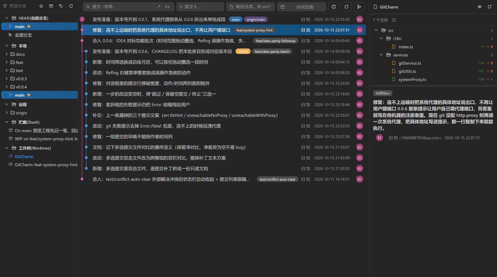
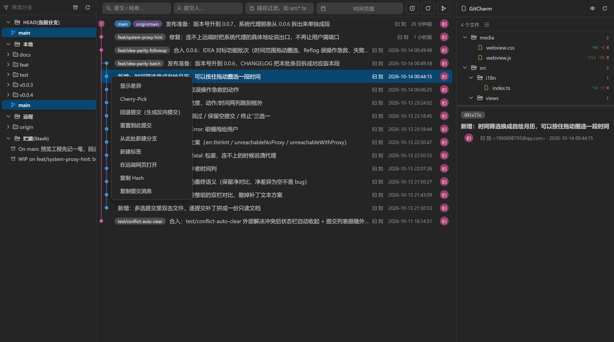
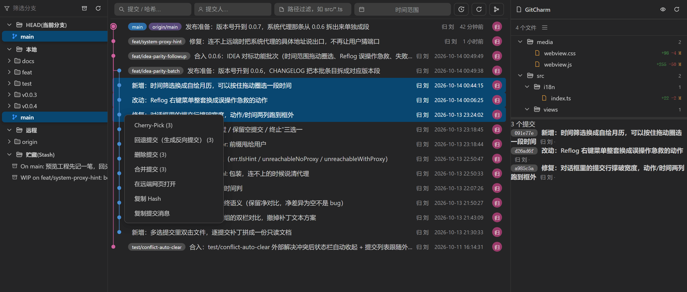
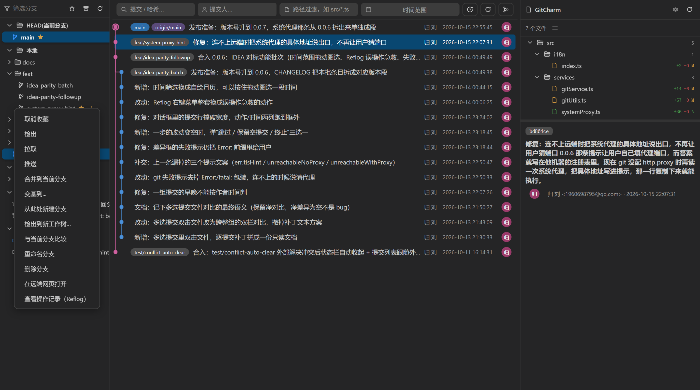
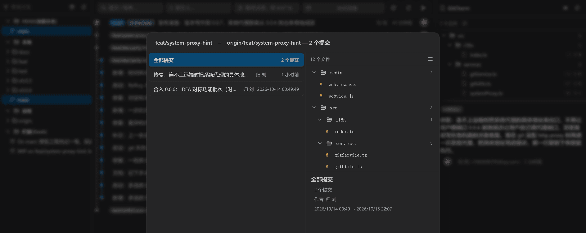
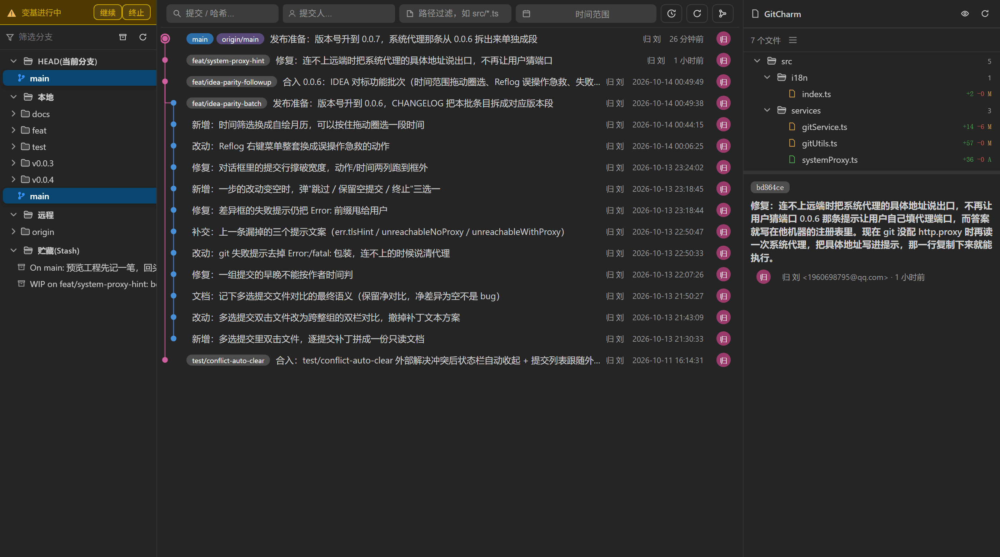
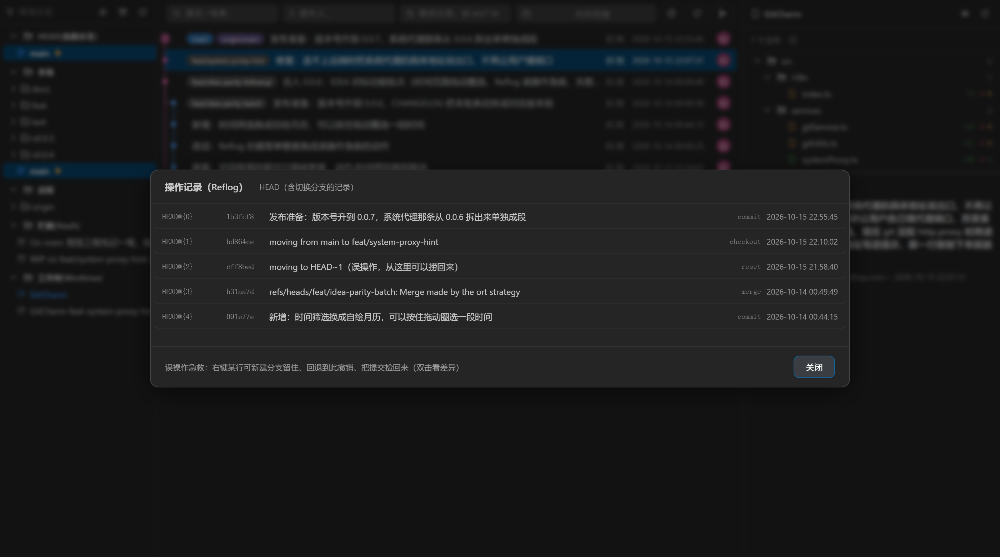
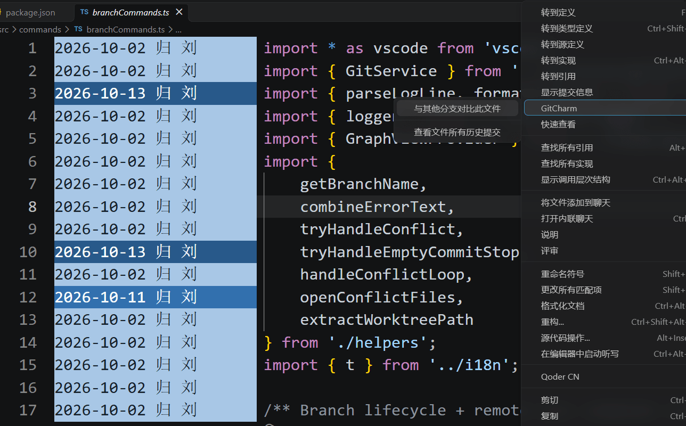
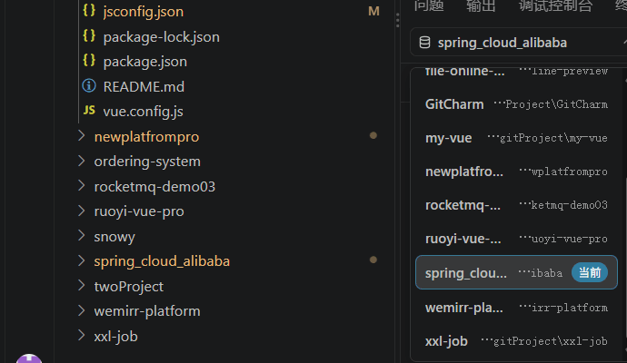

# 把 IntelliJ IDEA 的 Git 界面搬进 VSCode：GitCharm 使用说明

> 一款在 VSCode / Qoder 里复刻 IDEA Git Log 三栏面板与操作工作流的扩展。发布者 `liugui`，扩展 ID `liugui.git-charm`，当前版本 0.0.7，MIT 协议。

> **关于本文的配图**：面板截图分两种。标了**"示意图（真实界面 + 演示数据）"**的那些，渲染用的是扩展自己的 `webview.css` / `webview.js` 和仓库里真实的提交哈希、提交消息、文件增删行数，只有数据是预先准备好的样例（否则界面一改版截图就全部过期，见第七节末尾）；标了**"真实截图"**的那两张是 IDE 里直接抓屏，多仓库那张的仓库列表、Blame 那张的代码都是真东西。所以示意图里的分支名和提交信息当示例读，交互和菜单项与真实扩展一致。

---

## 一、为什么做这个插件

用惯了 IntelliJ IDEA 的人回到 VSCode 看 Git 历史，普遍会有个落差：

IDEA 的 Git log 是**三栏**的——左边分支树、中间提交图谱、右边这次提交改了哪些文件。想干什么都在这一屏里完成：右键一个分支能变基、右键几个提交能压缩、双击文件直接进对比。

VSCode 的情况是：源代码管理面板只看得到"未提交的改动"，要看历史得装 Git Graph / GitLens，而它们的交互逻辑和 IDEA 完全不是一套路子——分支操作藏在不同的面板，多选提交做不了 squash，推送前看不到待推送的提交列表。

GitCharm 的目标很单纯：**把 IDEA 那套三栏 Git 面板和操作习惯原样搬过来**，而不是再做一个 commit 图谱查看器。

---

## 二、界面长什么样

面板打开后是三栏布局（底部面板的 GitCharm 标签）：



*示意图（真实界面 + 演示数据）*

- **左栏 · 分支树**：按 `HEAD / 本地 / 远程` 分组的层级树，分支名后面带超前/落后箭头（▲▼）和提交数徽标；下面还有贮藏（stash）分区。
- **中栏 · 提交列表**：Canvas 绘制的提交图谱，每行是提交信息首行 + 作者 + 相对时间（24 小时内显示"3 分钟前"这种，超过则显示完整时间）。顶部工具栏是筛选区：消息、作者、路径、日期区间，按回车生效；框里显示的就是当前真正生效的条件——重新显示面板不会留下"框是空的、列表却还在按上次的词过滤"，把某个框删空则立刻按不过滤刷新。搜索框里嵌着 IDEA 那两个开关：`.*` 把关键词当正则表达式、`Cc` 区分大小写，默认按字面子串模糊匹配（`( . *` 是字符不是语法，不会再因为一个左括号报正则错误）。列宽不够时作者 / 路径 / 日期收进 `>` 浮层，工具栏始终一行；有看不见的筛选在生效时 `>` 会亮，一条都不剩时空态直接给"清除全部筛选"。
- **右栏 · 提交详情**：选中提交的完整信息（作者/提交者/时间/hash/所属分支与标签）+ 变更文件列表（每个文件的增删行数）+ 双击进差异对比（图片、jar 这类二进制文件不开文本对比，直接给一句提示）。

几个高频界面长这样：

**提交行右键菜单（单选）** — 显示差异、精选、压缩、删除、改提交信息、回退、重置，以及"在远端网页打开此提交"：



*示意图（真实界面 + 演示数据）*

**提交行右键菜单（多选）** — Ctrl/Shift 点几个之后，精选/删除/压缩变成批量操作，右栏文件列表合并成净结果：



*示意图（真实界面 + 演示数据）*

**分支节点右键菜单**：



*示意图（真实界面 + 演示数据）*

**推送对话框** — 推之前看得见要推的提交和文件清单，落后远程时才会出现强制推送按钮。文件多的时候可以点详情区标题栏的箭头把它折起来，把高度全让给文件列表；"与当前分支比较"对话框是同一套模板，行为一致：



*示意图（真实界面 + 演示数据）*

**冲突处理顶部状态栏** — merge / rebase / cherry-pick 进行中时钉在面板顶部，给出"继续 / 终止"入口：



*示意图（真实界面 + 演示数据）*

---

## 三、能做什么

### 分支

新建、检出、重命名、删除、合并到当前分支、变基到…、推送（落后远程时给强制推送）、拉取、获取、更新。

两个细节是照着 IDEA 的习惯来的：

- 树里**双击分支就切换**，文件夹单击展开；
- 删除/重命名分支后**不刷新界面**——先乐观更新，失败了再回滚。因为刷新一次要把三栏数据全重取，为了一个分支名变化让人等半秒不值得。

### 提交

显示差异（这次提交改动的全部文件在同一个多文件差异页里列出）、精选提交（Cherry-Pick）、压缩提交（Squash）、删除提交（Drop）、编辑提交信息（Amend）、回退提交（Revert）、重置到此提交（Reset，命令面板里也能直接执行，没选中提交时列出最近 50 条供选择）、在远端网页打开这个提交/这个分支。

**多选**是重点：Ctrl/Shift 点几个提交之后，右键的精选/删除/压缩都变成批量操作，第三栏的文件列表也会**跨这组提交合并**成一个净结果。

这里踩过一个值得说的坑：**一组提交谁先谁后，不能按作者时间判**。cherry-pick / rebase / amend 会保留原作者时间，落地顺序却是反的。实测过一个仓库里 `cfccce3`（作者时间 13:39）其实是 `5f8c82d`（作者时间 14:48）的**子**提交。按作者时间排序，"最早的父"和"最晚的"会算到同一个提交头上，差异框恒空，看着就像界面坏了；更麻烦的是压缩提交取 rebase 起点也会取错端点——那是在改历史。

顺序也不能按**点击顺序**判：这一度写成 `git rev-list --no-walk --topo-order`，而 `--no-walk` 恰好把"要排序的那次遍历"取消了，git 基本按你递给它的顺序回（实测线性历史喂 `b z a y` 得 `b z a y`）。现在真走一遍 `rev-list --topo-order` 再挑出选中项，才是历史顺序。

压缩提交本身也重新定义过一遍：**只折叠紧挨着的那几段**。选中 `y z` 得到 `x (y+z) w a b c`；选中 `y z a b`（中间 `w` 没选）得到 `x (y+z) w (a+b) c`——两段各问一次消息，各折各的，没被选中的提交保持原消息、原位置。以前是"把选中项并成一个块，再把编辑好的消息按在 HEAD 上"，所以压两条早期提交会把记录改到最新那条上，跨未选提交时还会把那些提交挪位置、撞上冲突停在半路的变基里。

多选后双击文件 = 跨这组提交的双栏对比：左边取**最早**提交的父版本，右边取**最晚**提交的版本，组里每个提交的改动都落在同一份 diff 里。

### Reflog：误操作急救

工具栏一个按钮看提交列表当前所选分支的操作记录（没选中分支时是 `HEAD`）；分支行右键不再重复放这个入口。

为什么单独强调这个：`checkout` 和 `reset` 只在 `HEAD` 的 reflog 里留痕，而这正是把工作"藏起来"的两个操作。一次 `reset --hard` 之后，被藏掉的提交在这个对话框里每一行都能查看差异、新建分支留住它、或者直接回退过去。



*示意图（真实界面 + 演示数据）*

### 标签 / 贮藏

- 标签：轻量或附注，删除本地，推送到远端。附注标签的 `refs/tags` 里存的是 tag 对象哈希而不是提交哈希，所以得穿过 tag 对象才能把徽章贴在对的提交上。
- 贮藏：分支树第三个分区列出整个栈，工具栏一键贮藏，行上可应用/弹出/删除。在终端里 `git stash` 也会自动跟上。

### 文件

与其他分支对比此文件、与当前本地文件对比、查看当前文件与最后一次提交的差异（编辑器 / 资源管理器右键的"查看差异"）、从提交里只挑一个文件、跳转到工作区里的该文件（提交中存在但工作区已删除的文件，菜单项灰显）、**打开历史版本（只读）**——按那次提交的版本只读打开这个文件，并停在本次改动的第一行，工作区里早已删掉的代码也能读（被这次提交删掉的文件会回退到父版本、按旧行号定位）、跨分支看这个文件的全部历史提交（直接打开编辑器的文件时间线）、看单次提交引入的差异。

### Blame

编辑器右键开启，行内注解每行的最后修改者与日期，悬停看完整提交信息，点击把中栏的提交列表改根到那条提交——上面是它之后的提交、下面是导致它的提交，选中行落在中间，两个方向都能滚。

开启自动换行时注解改挂在行尾：VS Code 的内联 `before` 内容只参与第一段可视行的排版，续行一律从行首开始，扩展也没有给续行加缩进的 API，所以"左侧固定列 + 续行对齐"在装饰里做不到；放到行尾后代码列和续行落在同一条左边线上，再长的行也不会错位。关闭换行时没有续行可言，保持 IDEA 那种左侧固定列。



*真实截图：行号右侧的日期 + 作者是逐行 Blame 注解（当前行有高亮），中间浮层是悬停看到的提交摘要，右边是编辑器右键菜单里的 GitCharm 子菜单。*

---

## 四、几个"只有真用过才知道"的设计

这部分是我觉得比功能列表更值得写的东西。

### 面板跟着真实 git 状态走

很多人习惯在终端里操作 git，界面就该跟上，而不是让人去点刷新：

- 在终端解决完冲突并提交，面板顶部那条"继续/终止"状态栏会**自己收起**。判据是 git 的状态文件（`MERGE_HEAD`、`CHERRY_PICK_HEAD`、`rebase-merge` 等）被清掉——只 `git add` 完还没 commit 时 `MERGE_HEAD` 还在，状态栏就必须留着，因为 merge 确实没结束。
- 在终端提交一次，中间的提交列表**自动重载**，并且保留你当前选中的提交、右栏详情、折叠状态和滚动位置。不带这个保留的话，用户每提交一次界面就跳回顶部、详情被清空。

实现上这些都是 `fs.watch` git 目录 + 2 秒轮询兜底，**全部是文件读取，不 spawn 子进程**。为什么还要留轮询：git 用 `HEAD.lock` + rename 覆写 `HEAD`，Windows 上文件级监听还能收到事件，但 macOS/Linux 的 inotify 绑的是 inode，rename 覆盖之后就变成一个从此静默无事件的孤儿监听——它不会报错，只是再也不通知你。

### 不依赖内置 Git 扩展

这是架构上最大的一次改动。早期版本是调 `vscode.git` 的 API 拿分支和提交历史的，后来全部拆掉了，原因有三条：

1. 激活内置扩展会触发一次多子进程的仓库扫描，大仓库秒级；
2. 它的 refs/HEAD 缓存滞后于真实变更；
3. `repo.log(branch)` 会忽略传进去的分支参数，`Commit.parents` 类型还不稳定。

现在分支列表和 `HEAD` 是**直接读 git 目录下的 refs 文件**（loose + packed-refs），超前/落后是单条 `git for-each-ref`。数百分支的仓库也不会卡。仓库位置统一由 `resolveGitDir()` 定位，因为 linked worktree 的 `.git` 是个 `gitdir:` 指针文件，refs 还在 `commondir` 指向的公共目录，直接拼 `.git/refs` 会读空。

代价是要自己处理凭据：远端要账号密码时，扩展自己挂 `GIT_ASKPASS` 弹输入框（机密项掩码），不再借内置 Git 的提示。

### 失败提示要能行动

原来 git 报错是直接 `String(error)` 甩出去，效果是：

```
Error: Error: fatal: unable to access ...
```

两遍 `Error:` 是因为命令执行器把同一句 stderr 同时写进了 `message` 和 `stderr`。现在统一走一个格式化函数，剥掉包装、去重、限制 4 行 400 字。

更值钱的是网络类失败会补一句**可以直接抄走执行的命令**。举个实测的例子：

> 我浏览器明明能上 GitHub，为什么插件推送连不上？

因为 git 不读注册表里的系统代理。这台机器的真实形状是：注册表 `ProxyEnable=0x1`、`ProxyServer=127.0.0.1:7890`，环境变量里一个 proxy 都没有，git 也没配 `http.proxy`——浏览器读注册表所以能上，git 直连 443 超时 21 秒。同一条 `git ls-remote` 加上 `-c http.proxy=http://127.0.0.1:7890` 不到 1 秒返回。

所以现在没配 `git config http.proxy` 时，会再去读一次 Windows 系统代理（`reg query`，argv 无 shell，非 Windows 直接返回 undefined，只在失败路径跑一次），读到就把**具体地址**写进提示，那一行复制下来就能执行。

顺带说清楚一件事：**为什么不干脆像浏览器那样自动用系统的网**？这条边界不在插件。核对过内置 Git 扩展上游源码，`git.ts`/`main.ts`/`askpass.ts` 里 `proxy` 出现 **0 次**——它同样是 spawn git，只有 VS Code 自己的流量（走 Electron/Chromium）才吃系统代理。所以"浏览器能上、面板连不上"是 git 的边界，不是实现差异。能做的是把这件事说清楚，而不是替 git 假装它读得懂注册表。

### 一步改动变空时，给用户三选一而不是 git 的建议文本

解决冲突时如果保留了对面已有的内容，这一步的补丁就成了空的，git 会停下打印一整段 advice：

```
The previous cherry-pick is now empty, possibly due to conflict resolution.
If you wish to commit it anyway, use:
    git commit --allow-empty
Otherwise, please use 'git rebase --skip'
```

那三行恰恰就是用户能做的三个选择，只是没人替他按。现在会认出这种停止，弹"跳过这个提交 / 保留这个空提交 / 终止"。

接入点必须排在**冲突判定之前**——那段 advice 里含 `Could not apply`，先判冲突会把用户赶去解决一批根本不存在的冲突。

### 一个工作区里多个仓库（多项目管理）

一个普通父目录下并排十几个独立仓库，是很常见的工程组织方式：前端一个、后端几个、示例若干，父目录本身不是仓库。内置 Git 能列全，早期版本只显示它顺手发现的那一个。

**发现仓库是"向上 + 向下"两条路。** 向上探测解决"我打开的文件夹在仓库里面"——一路 `dirname` 往上找 `.git`，全程只读文件、不 spawn 子进程（一 spawn 就把"没装 git"和"这不是仓库"混成同一个错误了）。向下扫描解决"父目录本身不是仓库"，它必须带三条护栏：命中仓库就不再往里列目录（仓库里面才是最大最无关的那部分）、跳过点目录和 `node_modules` / `dist` / `build` / `out` / `target` / `bin` / `obj` / `vendor` 这类依赖与构建树、深度和目录数各有上限。两条路的结果再按规范化后的路径去重，所以同一个仓库被多个 workspace folder 覆盖时只出一条。实测十几个仓库 5ms。

**当前看哪个仓库，由一个"钉住"的记号决定。** 在切换器里选过一次就写进工作区状态，下次启动先回去校验那个目录下的 `.git` 还在不在——判据是目录形态的 `.git` 里得有 `HEAD`，文件形态的 `.git` 得是 `gitdir:` 开头（那是 worktree 或子模块）。目录搬走了就静默交回自动发现，而不是抱着一个死路径让每条命令都报错。没钉住时按 workspace folder 的顺序向上探，再退到当前编辑器文件所在目录——也就是"没手动切过的话，面板跟着你正在看的文件走"。

**切换器是分支树上方的一枚标签 + 内联下拉，不是对话框。** 理由很实际：切仓库的时候你仍然要看得见分支树和提交列表，弹一个模态框正好把判断依据挡住。只有一个仓库时整个控件不出现（一个只有一项的下拉没有意义，还会让人以为坏了）。命令面板里的 `GitCharm: Switch Repository` 走 QuickPick，当前仓库打勾；仓库数不足两个时只给一句提示，不开空列表。



*真实截图：`gitProject` 父目录下并排的十几个仓库，下拉里带"当前"徽标的就是面板正在展示的那个。*

**切换只准走一条路径。** 面板上的下拉和命令面板那条命令，最后都进同一个 `switchRepository`，因为要处理的东西比看起来多：当前分支、选中提交、进行中的操作状态、还没落盘的视图快照全部重置；`.git` 目录监听、HEAD 监听、2 秒轮询、自动 fetch 全部按新仓库的 git 目录重新挂一遍。进行中操作的"继续 / 终止"状态条要**立刻**清掉再刷新——它原本只由那个目录监听负责收起，而监听已经指向另一个仓库了，不清就会把上一个项目的冲突状态挂在这边下不来。反过来，**文本 / 作者 / 日期 / 路径过滤器一律保留**：那是用户输入而不是仓库状态，清掉只会让输入框和实际生效的过滤条件不一致。

**为什么要清这么狠**：git 允许不同项目有重名分支和相同的短哈希。一个"看着像真的"的旧分支名或旧提交哈希被带进新仓库，会被读成真实数据，然后对着错误的对象执行写操作。缓存因此分两类处理——分支列表、图数据、提交详情、文件增删这些**键里带仓库路径**，切走再切回来仍然命中；而提交索引是**只按裸哈希**键的，跨仓库必撞，所以切换时必须整体清空，这是硬约束不是保守。持久化的分支缓存和视图快照各自盖了 `repoPath`，对不上就丢弃；视图快照还多一道 2 小时有效期，跨天恢复一个早就不存在的选中提交没有意义。

**面板只盯活动仓库，不给每个仓库各开一套监听。** 十几个仓库各自 2 秒一轮查询是纯浪费，所以文件监听和定时 fetch 都只跟当前这一个。唯一的例外是"`.git` 出现 / 消失"这件事按每个 workspace folder 全量监听：任何一个文件夹里新建或删除了仓库，都会触发一次重扫 + 清缓存 + 重新选路。这是为了"删掉一个仓库不该让面板一片空白"——只要还有别的仓库在，就立刻换过去继续显示。

**目前的边界**：没有"一键 fetch all / pull all"，多仓库严格一次看一个、操作一个，需要批量请回到终端；向下扫描有深度上限，嵌得更深的仓库（`A/B/C/repo` 这种）看不见，而向上探测也帮不上，因为打开的文件夹本来就在它们上面；自动 fetch 的间隔是全局一个值，只对当前仓库生效。

---

## 五、性能

- **秒开**：三阶段渐进加载（骨架屏 → 分支 → 提交），启动 < 10ms。
- **直读 refs**：不 spawn 子进程取分支列表。
- **智能缓存**：分支信息持久化到工作区状态（Memento），重启立即可用；对 git 目录做文件监听，在别处提交/拉取/切分支时自动失效。持久化结构带 `version` 字段 + schema 校验，读到坏数据自愈而不是崩。
- **Canvas 图谱**：提交图用 Canvas 像素级绘制，高 DPI 自适应，比 SVG/DOM 高效数倍。
- **打包体积**：VSIX 从 442KB 降到 156KB（剔除 README 截图、测试代码、文档等不参与运行的文件）。

---

## 六、安装与使用

### 环境要求

- VSCode ≥ 1.66.0，或 Qoder 最新版
- Git ≥ 2.0.0
- **不需要**内置 `vscode.git` 扩展，禁用它也能正常用

### 安装

**方式一（推荐）**：扩展面板搜索 `GitCharm`（完整名 *GitCharm — IDEA Git Log & Graph*，发布者 `liugui`）。

**方式二**：下载 `git-charm-<版本>.vsix` → 命令面板执行 `Extensions: Install from VSIX…` → 选文件、重载窗口。

### 上手

1. 打开一个 Git 仓库工作区。没有 `.git` 的文件夹同样能打开面板，会给引导页并可一键 `git init`。
2. 点底部面板的 **GitCharm** 标签。
3. 文件夹单击展开，分支**双击切换**，右键节点/提交行呼出操作菜单。

### 常用操作对照

| 想做什么 | 入口 |
|---|---|
| 切换分支 | 分支树双击，或右键 → 检出 |
| 查看提交详情 | 单击中栏提交行 |
| 查看提交差异 | 提交行右键 → 显示差异（该提交的全部文件） |
| 合并 / 变基 | 分支右键 → 合并到当前分支 / 变基到… |
| 推送 / 拉取 | 分支右键 → 推送 / 拉取 |
| 精选提交 | 多选提交 → 右键 → 精选提交 |
| 压缩提交 | 多选提交 → 右键 → 压缩提交 |
| 删除 / 改提交信息 | 提交行右键（仅 HEAD 附近可用） |
| 与其他分支对比文件 | 编辑器 / 资源管理器右键 → GitCharm → 与其他分支对比此文件 |
| 看某文件在这次提交里的改动 | 右栏变更文件双击（图片、jar 等二进制文件只给一句提示，不开文本对比） |
| 读某文件在那次提交时的样子 | 右栏变更文件右键 → 打开历史版本（只读），落在本次改动的第一行 |
| 与本地文件对比 | 右栏变更文件右键 → 与当前本地文件对比 |
| 看当前文件未提交的改动 | 编辑器 / 资源管理器右键 → 查看差异 |
| 挑选提交中的单个文件 | 右栏变更文件右键 → 挑选文件 |
| 文件历史(原生) | 编辑器 / 资源管理器右键 → GitCharm → 文件历史(原生)（打开时间线） |
| 显示 Blame | 编辑器右键 → 显示提交信息，或点击行号区域 |
| 误操作急救 | 工具栏 Reflog 按钮（跟随提交列表所选分支） |

### 设置项

设置里搜 `idea-git`：

| 配置 | 说明 | 默认 |
|---|---|---|
| `idea-git.cache.enabled` | 缓存分支信息以加快启动（持久保存，仓库变化或执行 Git 操作时更新） | `true` |
| `idea-git.prefetchOnStartup` | 扩展激活后立即预取面板首屏（提交、分支、HEAD），打开面板无需等待；启动时会多跑几条 Git 命令 | `true` |
| `idea-git.pullStrategy` | 拉取策略：`merge` 或 `rebase` | `merge` |
| `idea-git.language` | 界面语言：`auto` / `zh-cn` / `en` | `auto` |
| `idea-git.autoFetchMinutes` | 面板打开期间每 N 分钟静默 fetch 一次远端，只更新分支树与箭头；不弹凭据框、不弹错误，仓库没远端时一个子进程都不启（`0` 关闭） | `0` |
| `idea-git.debug` | 调试日志（输出到扩展宿主控制台） | `false` |

---

## 七、自己跑一遍 / 参与开发

```bash
npm install        # 装依赖（含 @vscode/vsce）
npm run compile    # TypeScript 编译到 out/
npm run lint       # ESLint，要求 0 error
npm test           # node:test 单元测试
npm run package    # 打包 VSIX
```

在 VSCode / Qoder 里按 **F5** 启动"扩展开发宿主"调试（配置见 `.vscode/launch.json`）。

> 一个坑先替你踩了：改完 `out/` 或 `media/` 后，开发宿主跑的仍是旧代码，必须**完全重启宿主**再验证，必要时递增版本号让缓存失效。

### 目录结构

```
src/
  extension.ts        激活入口：组装依赖、注册命令与视图
  commands/           命令层，按域拆分（branch / commit / operation）
  services/           服务层：gitRunner / gitService / refsReader /
                      persistedBranchCache / blameProvider / logger
  views/              graphView.ts（WebviewViewProvider）+ messages.ts（消息协议）
  test/               node:test 单测
media/                webview 前端（webview.js / graph.css / codicons）
```

依赖方向是 `commands → services ← views`，服务层不反向依赖命令层。

### 两条写代码前必须知道的规矩

**所有 git 命令必须走 `GitCommandRunner`**：argv 数组直接 `spawn`，**没有 shell**。早期版本有个 `execAsync` 回退分支，已经彻底删除，不允许加回来。参数不写字面引号（无 shell，引号会进入参数值——真实踩过分支名带引号导致解析失败）；提交消息类内容走 `-F` 文件或 stdin，不拼进命令行；路径过滤一律追加在 `--` 之后，有它兜底，前导 `-` 就不可能被 git 当成选项。

**能被单测 import 的模块禁止 `import vscode`**：测试是纯 node 跑的，没有 vscode 的 stub。所以连日志模块包的也是 `console` 而不是 `OutputChannel`。

### 本文的截图是怎么来的

界面截图不用开 IDE、也不用手动摆数据，仓库里有一条可复现的链路（`docs/preview/`）：

```bash
node docs/preview/build-preview.mjs          # 从 graphView.ts 的模板抽出真实 DOM 骨架，注入演示数据
node docs/preview/shot.mjs main branchMenu   # 无头 Chrome 截图，随后裁掉空白、量化压缩
```

关键是这套预览**加载的是扩展自己的 `media/webview.css` 和 `media/webview.js`**，只把 `acquireVsCodeApi()` 换成一个 shim，按 `src/views/messages.ts` 里的真实协议把演示数据喂进去（`setRepoState` / `setData` / `setDivergence` / `setDetail` / `showPushDialog` / `showReflog`）。菜单、对话框、多选高亮都是派发真实 `MouseEvent` 走真实代码路径弹出来的，不是画出来的假界面——所以界面改版后截图会跟着变，改一行演示数据就能重出一批。

截完之后 `shot.mjs` 还有两步收尾：从底部往上扫像素，把提交列表下面那一大片纯背景裁掉（视口固定 780px 高，内容往往只占三分之二）；再把 32 位 PNG 量化成 128 色调色板，一张从 480KB 掉到 180KB 左右，肉眼看不出差别。压缩用的 sharp 故意**不是**扩展的依赖，脚本按 `NODE_PATH` 去找它，找不到就跳过这步并提示一句。

标"真实截图"的那两张（Blame、多仓库切换器）走的是另一条路：真机抓屏后手工裁掉无关区域——活动栏、资源管理器、任务栏、状态栏上的邮箱这些都不进图。它们进 `docs/images/`，和自动生成的 `docs/preview/out/` 分开，免得被下一轮重截覆盖掉。

两个已知缺口：示意图里的文件图标没有注入图标包，走的是兜底样式；预览页没有 IDE 外壳（活动栏、标签页）。还有一个坑值得记：无头截图会把 CSS 入场动画冻在第 0 帧，而面板的动画从 `opacity: 0` 起步，整页会拍成半透明——预览主题里全局关掉 animation/transition 才正常。

要一份能直接发给别人的 Word 版：

```bash
npm i sharp docx --registry=https://registry.npmmirror.com   # 只给脚本用，不进扩展依赖
NODE_PATH=<上面那个目录>/node_modules node scripts/build-docx.mjs
```

脚本按这份 markdown 重排成 `.docx`，9 张图缩到 1400px 宽、量化后内嵌进包里（0.9MB，发出去不带图文件夹也不掉图）。中文正文用微软雅黑、代码用 Consolas、二级标题分页。产物不提交（`docs/*.docx` 已忽略），markdown 才是源头——改了文章重跑一次就有 Word 版。

---

## 八、技术栈

TypeScript · VSCode Extension API · Git CLI · Webview（Canvas 渲染）

许可证：MIT。完整版本历史见仓库 `CHANGELOG.md`。

---

## 结语

这个插件最有价值的部分其实不是"复刻了 IDEA 界面"，而是**把 IDEA 里那些理所当然的交互补齐**：多选提交能压缩、推送前看得见要推什么、在终端里操作完界面会自己跟上、git 报错时给的那句话是能直接执行的。

如果你也是从 IDEA 切到 VSCode、每次看 Git 历史都要叹一口气的人，可以装上试试。有建议或者报 bug，欢迎在 CSDN 评论区或者 GitHub 上提。
